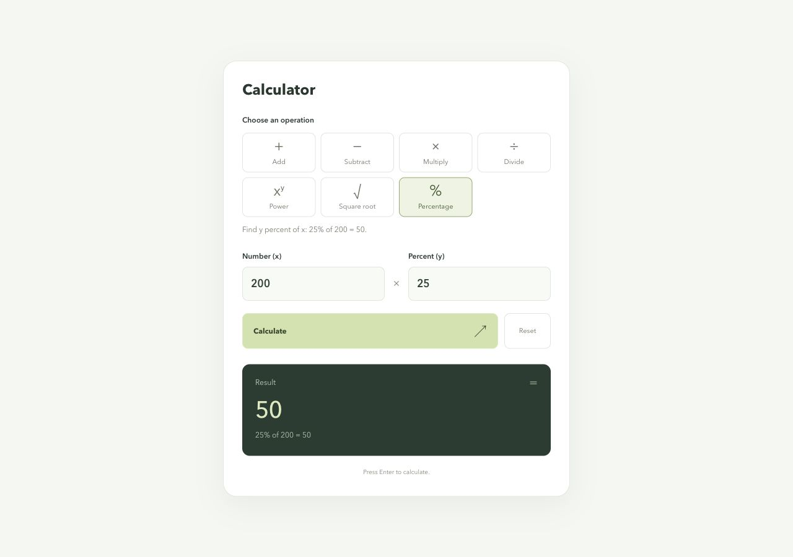

# Calculator

A calculator with a React and TypeScript frontend and a Go REST API. All arithmetic runs on the backend.

Live demo: [furkankale.dev](https://furkankale.dev). Hosted on AWS EC2.

Supports addition, subtraction, multiplication, division, powers, square roots, and percentages.



## Setup

Requirements:

- Node.js 24 LTS
- pnpm 11.25.0, installed with `npm install --global pnpm@11.25.0`
- Go 1.24 or newer

Run the backend from the repository root:

```sh
cd backend
go run ./cmd/server
```

In a second terminal, run the frontend from the repository root:

```sh
cd frontend
pnpm install --frozen-lockfile
pnpm dev
```

Open [http://127.0.0.1:5173](http://127.0.0.1:5173). The backend listens on port 8080. Vite forwards `/api` requests to it. Both processes must be running.

## Production build

After installing the frontend dependencies, run from the repository root:

```sh
cd frontend
pnpm build
cd ../backend
STATIC_DIR=../frontend/dist go run ./cmd/server
```

Open [http://127.0.0.1:8080](http://127.0.0.1:8080). Go serves both the built frontend and the API.

| Environment variable | Default | Purpose |
| --- | --- | --- |
| `ADDR` | `:8080` | HTTP listen address |
| `STATIC_DIR` | unset | Directory containing the built frontend, relative to the server's working directory |

Use `ADDR=127.0.0.1:8080` to listen only on loopback. If changing the backend port during development, update the proxy in `frontend/vite.config.ts` too.

## API

### POST /api/calculate

Send JSON with `Content-Type: application/json`. Operands and results are decimal strings. Inputs reach the backend without losing digits.

```sh
curl -s http://127.0.0.1:8080/api/calculate \
  -H 'Content-Type: application/json' \
  -d '{"operation":"add","a":"12","b":"3"}'
```

Response:

```json
{"result":"15"}
```

| Operation | Request | Result |
| --- | --- | --- |
| Add | `{"operation":"add","a":"12","b":"3"}` | `"15"` |
| Subtract | `{"operation":"subtract","a":"12","b":"3"}` | `"9"` |
| Multiply | `{"operation":"multiply","a":"12","b":"3"}` | `"36"` |
| Divide | `{"operation":"divide","a":"12","b":"3"}` | `"4"` |
| Power | `{"operation":"power","a":"2","b":"10"}` | `"1024"` |
| Square root | `{"operation":"sqrt","a":"81"}` | `"9"` |
| Percentage | `{"operation":"percentage","a":"200","b":"25"}` | `"50"` |

Percentage calculates `b` percent of `a`. In the UI, `a` is Number (x) and `b` is Percent (y). Square root uses only `a`, with `b` omitted or `null`. Every other operation requires both numbers.

Zero, negative numbers, decimals, and scientific notation are accepted where the operation allows them. JSON numbers, unknown fields, malformed JSON, and multiple JSON values are rejected. Send operands as strings, such as `"0.1"` or `"1e25"`. The request body limit is 4096 bytes.

For example, `{"operation":"add","a":"0.1","b":"0.2"}` returns `{"result":"0.3"}`. Adding `"0.2"` to `"1e25"` returns `"10000000000000000000000000.2"`. React displays this as `1e+25` while retaining the original value. `0.1^35` returns `"0.00000000000000000000000000000000001"`, which React displays as `1e-35`.

Division by zero returns HTTP 400:

```sh
curl -i http://127.0.0.1:8080/api/calculate \
  -H 'Content-Type: application/json' \
  -d '{"operation":"divide","a":"12","b":"0"}'
```

```json
{"error":{"code":"invalid_calculation","message":"Cannot divide by zero."}}
```

| Status | Meaning |
| --- | --- |
| 200 | Calculation completed |
| 400 | Invalid input or mathematical error |
| 404 | Unknown API endpoint |
| 405 | Unsupported method, with an `Allow` response header |
| 413 | Request body too large |
| 415 | Missing or incorrect content type |

### GET /api/health

```sh
curl -s http://127.0.0.1:8080/api/health
```

```json
{"status":"ok"}
```

## Tests and coverage

From `backend/`:

```sh
go vet ./...
go test -race -coverprofile=../reports/backend.out ./...
go tool cover -func=../reports/backend.out
go tool cover -html=../reports/backend.out -o ../reports/backend.html
```

From `frontend/`:

```sh
pnpm test:coverage
pnpm build
```

Use `pnpm test:watch` to run frontend tests while editing. The build includes TypeScript checking.

[Coverage results](reports/README.md) are included in the repository. The frontend coverage command also generates `reports/frontend/index.html`, which is ignored by Git.

GitHub Actions runs backend checks and frontend checks in separate jobs on pushes and pull requests. Both jobs upload coverage reports. The workflow does not deploy the application.

## Design decisions

- The calculation function is separate from HTTP handling so arithmetic rules can be tested directly. Go's standard library handles HTTP and JSON. shopspring/decimal handles arithmetic.
- One calculation endpoint handles all operations. The operation name selects the rule, while input validation and error responses are shared.
- React keeps inputs, API operands, and results as strings and validates input syntax on submission. The backend validates every request independently. Editing inputs clears the previous answer, and controls are disabled while a request is pending.
- Development uses Vite's API proxy. Production serves the frontend and API from the same origin, so CORS configuration is not needed.
- Addition, subtraction, multiplication, and percentages retain exact decimal results. Inexact operations use arithmetic precision 16. Division and square roots use extra decimal places for small values to preserve tiny results. Powers use the library's precision 16 and its fallback for tiny results. The API returns the resulting decimal string without screen-width rounding.
- React formats results with [decimal.js](https://mikemcl.github.io/decimal.js/). It uses up to 16 decimal places and reduces fractional places to fit 20 characters. Scientific notation is used for nonzero values with an absolute value below `0.000001` and for integers too wide to fit. Rounding ties go away from zero, and unnecessary trailing zeros are removed.
- Display formatting never converts the value to a JavaScript number. The original API result remains in React state and is available in the result's hover tooltip. The main result uses responsive text and stays on one line. Calculation precision and display formatting are independent.
- Percentage is `a * (b / 100)`. Rates below zero or above 100 are allowed. Power defines `0^0 = 1`. Negative square roots, non-real powers, and division by zero return errors.
- Operands are limited to 128 characters. Their values must be greater than `-10^1001` and less than `10^1001`. Nonzero values must have an absolute value of at least `10^-1000`. Power exponents must be between -1000 and 1000. These bounds keep requests and calculations manageable.
- The server limits request size and has HTTP timeouts. The frontend cancels requests after ten seconds. No database or authentication is needed for the calculator.

### Why shopspring/decimal

Go's `float64` and JavaScript's `number` use binary floating point. They cannot represent values such as `0.1` and `0.2` exactly, so adding them at runtime can produce `0.30000000000000004`. For a calculator, the expected answer is `0.3`.

shopspring/decimal preserves decimal values and provides exact addition, subtraction, multiplication, and percentage calculations. Its API also supports division, powers, and square roots, keeping the arithmetic code straightforward without implementing a custom number type.

Inputs and results are sent as JSON strings and parsed directly as decimals to avoid losing precision through floating point conversion. Results such as `1 / 3` and `sqrt(2)` still require rounding because their decimal expansions do not stop. The backend controls calculation precision, while React handles display rounding and scientific notation.

## Docker

From the repository root, with Docker running:

```sh
docker build -t calculator .
docker run --rm -p 8080:8080 calculator
```

Open [http://127.0.0.1:8080](http://127.0.0.1:8080).

The image build runs tests and compiles both layers. The final image contains a static Go binary and the frontend assets, and runs as a non-root user.

## Files

| Path | Contents |
| --- | --- |
| `backend/cmd/server/` | Server configuration and shutdown |
| `backend/internal/calculator/` | Arithmetic rules and tests |
| `backend/internal/httpapi/` | HTTP handlers and tests |
| `frontend/src/` | React UI, API client, input parsing, styles, and tests |
| `frontend/public/` | Favicon |
| `frontend/pnpm-lock.yaml` | Locked frontend dependencies |
| `docs/` | Desktop and mobile screenshots |
| `reports/` | Coverage summary and generated reports |
| `.github/workflows/ci.yml` | Automated tests and builds |
| `Dockerfile` | Container build |
